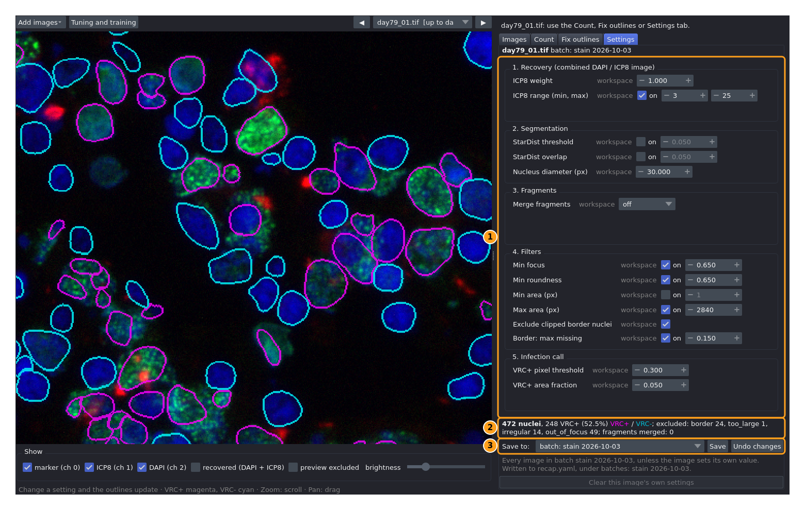

# 4. Guided settings

[← 3. First pass](03-first-pass.md) · [Guide](README.md) · Next: [5. Tuning →](05-tuning.md)

The **Settings** tab (Guided mode) shows an image's settings in the order recap uses them and redraws the result as
you change them, so you can see what each setting does before saving it for a batch or an image.

## US-13 Adjust settings step by step

*As a lab member, I adjust an image's settings step by step and watch the outlines and counts change.*

Open an image and choose the **Settings** tab. recap's outlines from the last run are hidden; the
preview shows VRC+ nuclei in magenta and VRC− in cyan, with the counts below.

| Step | Settings | What they do |
|---|---|---|
| 1. Recovery | ICP8 weight, ICP8 range | How the DAPI and ICP8 channels are combined into the image the model sees. Raise the weight when infected nuclei have weak DAPI. Fix the range per staining batch. [How recovery works](../pipeline.md#1-recovery). |
| 2. Segmentation | StarDist threshold, StarDist overlap, nucleus diameter | How sure the model must be, how much nuclei may overlap. |
| 3. Fragments | Merge fragments | Rejoin nuclei the model split into pieces. |
| 4. Filters | Min focus, min roundness, min / max area, border | Which outlines count as real, whole, in-focus nuclei. |
| 5. Infection call | VRC+ pixel threshold, VRC+ area fraction | When a nucleus counts as VRC+. |



1. **The five steps**, each setting with the tag of the level it comes from (*workspace*,
   *batch* or *image*, US-16) and its value; an optional setting has an *on* box.
2. **The preview's counts**: nuclei, VRC+, what the filters excluded and why. On the image, VRC+
   outlines are magenta and VRC− cyan; tick *preview excluded* in the Show bar for the excluded
   ones, or *recovered (DAPI + ICP8)* for the image the model sees.
3. **Save to:** the workspace, the image's batch or this image (US-14, US-15); **Save**; **Undo
   changes** (back to the saved values). The grey line under it says what the choice affects.

What each step does to the image, and why: [How recap counts](../pipeline.md).

Hover any setting for an explanation. Filters and the infection call update in about a second;
steps 1 and 2 rerun the model (*Segmenting...*, a few seconds). **Undo changes** returns to the
saved settings.

**Done when:** the preview follows your changes; leaving the Settings tab or opening another
image with unsaved changes asks first.

**Watch out for:** a run always uses the *saved* settings. Change, look, then save (US-14, US-15).

## US-14 Save settings for a whole staining batch

*As a lab member, I save settings that suit a whole staining batch.*

In the Settings tab choose **Save to: batch: NAME** and **Save**. The line under the choice says
what it affects:

| Save to | Affects | Terminal |
|---|---|---|
| workspace | every image | `recap settings set filters.min_focus=0.6` |
| batch | every image in the batch | `recap settings set --batch "stain A" normalization.vrc_range="[3, 30]"` |
| this image | only this image; needs a reason | `recap settings set --image IMG normalization.vrc_weight=1.3 --reason "weak ICP8"` |

Every level is written into the workspace's `recap.yaml`, keeping its comments: the
workspace's values in its own sections, a batch's under `batches:`, an image's (with the reason,
who saved it and when) under `images:` at the end of the file:

```yaml
batches:
  stain A:
    normalization:
      vrc_range: [3, 30]
images:
  raw/batches/stain A/day79_04.tif:
    reason: weak ICP8
    by: ana
    date: '2026-11-25'
    normalization:
      vrc_weight: 1.3
```

So recap.yaml is the one place to read, compare or back up every setting; you may also edit it
by hand (then More > **Rescan folder**). Only values that differ from the level above are stored. If a more specific level still sets
the same value for this image, recap says so (that level keeps winning).

**Done when:** the batch's images are marked *out of date* (with a **Run this image** banner on
the open one), another image of the batch shows the value tagged *batch*, and **Run out-of-date**
brings them up to date.

**Tip:** tune on one representative image of the batch, save to the batch, then check two or
three other images of the batch in the Settings tab before running them all.

## US-15 Give one weakly stained image its own settings

*As a lab member, I give one weakly stained image its own settings and say why.*

Choose **Save to: this image**, give the reason (for example "weak ICP8 in this field"). The
image gets *yes* in the *own settings* column and the reason goes into every output
(`settings_reason` in the image summary), so it is never hidden.

**Clear this image's own settings** (or `recap settings clear --image IMG`) removes them; the
batch's and the workspace's values apply again. `recap settings unset KEY --image IMG` removes
one value.

**Done when:** values are tagged *image*, and clearing brings back the batch's values.

**When not to:** an image that is out of focus, damaged or saturated should be excluded, not
rescued. Own settings are for valid images whose staining is weaker or uneven but correctable.

## US-16 See where each setting comes from

*As a lab member, I can tell where each of an image's settings comes from.*

The grey tag before each value says where it comes from: *workspace*, *batch* or *image*
(hover for details). In a terminal, `recap settings show IMG` lists every value that differs
from recap.yaml and which level set it.

**Done when:** the tags and `recap settings show` agree.

**What cannot vary:** the model (method and model version) is the same for the whole
workspace, so results stay comparable. Levels can change recovery, segmentation thresholds,
fragments, filters, the infection call and blanked regions (`input.exclude_regions`).
