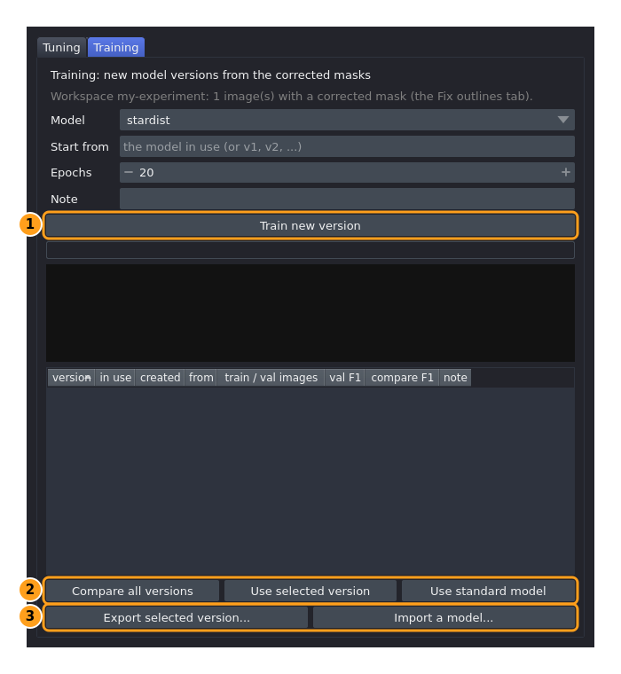

# 6. Train and run all

[← 5. Tuning](05-tuning.md) · [Guide](README.md) · Next: [7. Keep and share work →](07-keep-and-share.md)

## US-18 Train a new model version

*As a lab member, I train a new model version on my corrected masks and compare it with earlier ones.*

| In the app (**Tuning and training** > **Training**) | In a terminal |
|---|---|
| **Train new version** (Model: stardist; Start from: empty = the model in use, or v1, v2...) | `recap train --epochs 20` (`--start v1`) |
| **Compare all versions** | `recap models compare` |
| select the best version, **Use selected version** (or **Use standard model**) | `recap models use v2` (`recap models use standard`) |
| **Run out-of-date** in the Images tab | `recap run --out-of-date` |



1. **Train new version**, with the model, the version to start from, the epochs and a note above
   it; progress appears below, then the new version in the table (*in use*, its training and
   validation images, its score).
2. **Compare all versions**, **Use selected version**, **Use standard model**.
3. **Export selected version...**, **Import a model...** (US-32).

Each version is saved in `recap-data/models/stardist/vN` and never overwritten. Images with
corrected masks are split into training and validation; the new model and the one it started
from are both scored on the validation images, so you can see whether training helped. The
comparison scores every version on the same images; `n_trained_on` shows how many of them a
version was trained on (its scores there are optimistic).

Choosing a version writes it into recap.yaml for the whole workspace, so every image becomes
*out of date* until it is run again.

**Done when:** the new version has a score, *in use* moves to the version you chose, and after
the run every image is up to date. Write down how long training took (it runs on the CPU:
minutes to an hour).

**Watch out for:** train on at least 5 corrected images from several batches. Each image is
prepared with its own batch and image settings before training, which is what makes the model
hold up on images of varying staining quality. Cellpose training (`--method cellpose`) has not
been run yet: report what happens.

## US-19 Run all images with the chosen model and settings

*As a lab member, I run all images with the chosen model and each batch's and image's settings.*

**Run out-of-date** (or **Run all**) in the app, or `recap run` in a terminal.

**Done when:** every image is *up to date*, and `image_summary_*.csv` lists for each image the
levels used (`settings`), what they changed (`overridden`) and why (`settings_reason`).

## US-20 Report recap's counts against the manual counts

*As the PI, I get a report comparing recap's counts with the manual counts.*

| In the app | In a terminal |
|---|---|
| More > **Report: recap vs manual counts** (report.md opens) | `recap report` |

The report goes to `processed/reports/<date>/`. It compares the workspace's results (each
image's latest run) and every comparison run with the manual counts. `report.md` summarises it; `summary.csv` has,
per method, the total difference, the per-image bias with 95% limits of agreement, % VRC+ (recap
vs manual) and, for counts with clicked points, missed / merged / extra nuclei.
`inter_rater.csv` compares people who counted the same image. Images are matched by content, so
renamed copies still match.

**Done when:** the numbers make sense against what you saw in the images.

### Comparing two methods

To compare StarDist with Cellpose on the same images without changing the workspace's results:

```bash
pixi run -e cellpose recap run examples --settings examples/other_settings/cellpose.yaml
#   -> examples/processed/comparisons/results_cellpose/
recap report examples                 # recap (StarDist) and results_cellpose against the manual counts
recap compare examples/processed/runs/<date> examples/processed/comparisons/results_cellpose   # overlays
```

`--settings` makes a comparison run: the workspace's images (not the ignored ones), with their
batch and image settings, but that file's settings in place of recap.yaml's own sections, into
`processed/comparisons/<that file's output.directory>/` (one flat folder). There is no spot check,
and the images' results and *up to date* state stay those of the workspace's own runs. Keep such
files in a subfolder such as `other_settings/`.

Each image's folder holds the outputs of its latest run only. To compare two settings of the
workspace image by image, make one of them a comparison run.
