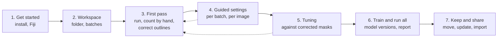

# recap user guide

How to use recap from start to finish, for the lab and for the undergrads who test and develop
it. Each page follows one stage of the workflow and is organised by the **user stories** of the
test plan (US-01 to US-30): what you want to do, how to do it in the app and in a terminal, how
to tell it worked, and what tends to go wrong.



> [!WARNING]
> recap is **under development**. Check its counts against manual counts before relying on them,
> and keep copies of your images; you use it at your own risk (see the README and the MIT license).

The lab's workflow is: **recover, segment and count by hand first; then tune; then, once a few
images are counted and corrected, train and run everything.** The dotted arrows are normal: you
go back to counting and correcting whenever the settings change.

| Stage | Page | Stories |
|---|---|---|
| 1. Get started | [Install, open the app, set up Fiji](01-get-started.md) | US-01 to US-04 |
| 2. Set up the workspace | [Your folder of images, adding or leaving out images, staining batches](02-workspace.md) | US-05, US-29, US-30, US-06 |
| 3. First pass and manual counts | [Run, look, count, correct](03-first-pass.md) | US-07 to US-12 |
| 4. Guided settings | [Settings for a batch or one image, with a live preview](04-guided-settings.md) | US-13 to US-16 |
| 5. Tuning | [Let recap find better settings](05-tuning.md) | US-17 |
| 6. Train and run all | [Model versions, the full run, the report](06-train-and-run-all.md) | US-18 to US-20 |
| 7. Keep and share work | [Import, move, update, terminal and app together](07-keep-and-share.md) | US-21 to US-25, US-28 |
| Handoff and testing | [Using the test plan, reporting problems](08-testing-and-handoff.md) | US-26, US-27 |
| Words used | [Glossary](glossary.md) | |

## Three things to know first

1. **A workspace is a folder of images.** recap adds one settings file, `recap.yaml` (every
   setting: the workspace's, each batch's, each single image's), and one folder, `recap-data/`
   (with the database `recap.db`: runs, counts, corrected outlines, which image is in which
   batch, model versions). An optional `.recapignore` lists images to leave out. Copy the folder
   and you copy all of it.
2. **The app and the terminal are the same program.** Every button calls the same code as a
   command (the table in [`docs/gui.md`](../gui.md) lists them), and both read and write the
   same workspace. Use whichever you like; mix them freely.
3. **Settings come in levels:** the workspace (`recap.yaml`, every image) → a staining batch →
   one image. The most specific wins. Images stained together share a batch's settings; a valid
   image with weak staining can get its own, with a written reason.

## The recap window at a glance

```
[Add images ▾] [Tuning and training]                 [◀] [day79_01.tif  [up to date] ▾] [▶]
┌──────────────────────────────────────────────┐  ( banner when the image is out of date: [Run this image] )
│                                              │  [ Images | Count | Fix outlines | Settings ]
│               the image                      │
│   scroll = zoom, drag = pan                  │  Images:  Workspace [my-experiment ▾] [Open...] [New...]
│                                              │           [all images ▾]  filter: out of date, not counted, ...
│                                              │           image | batch | recap (VRC+) | state | manual | corrected | ...
│                                              │           [Run selected] [Run out-of-date] [Run all]
│                                              │           [Open image] [Set batch...] [Summary] [More ▾]
│                                              │  Count:   click = VRC-, Shift+click = VRC+, right-click = remove
│                                              │           [Undo] [Clear] [Save count]  [Count this image in Fiji instead]
│                                              │  Fix outlines: [Draw new] [Delete] [Split] [Merge]  [Undo] [Save corrected mask]
└──────────────────────────────────────────────┘  Settings: five steps with a live preview; Save to: workspace / batch / this image
Show: [x] marker (ch 0) [x] ICP8 (ch 1) [x] DAPI (ch 2)  ...  brightness ───○───
```

Each tab shows only what it needs: no recap outlines while you count, only the preview in
Settings. Ctrl+1 to Ctrl+4 switch tabs. `recap gui --napari` opens the older layout (full
napari with recap's panels) if you need napari's own tools.

**State** tells you whether recap's count for an image is still valid: *up to date*, *out of
date* (its settings or the model changed since it was run), *not run*, or *unknown* (recap.yaml
is invalid). **Run out-of-date** fixes all of them at once.

## For the undergrads

- The test plan (a shared sheet with *User stories* and *Technical checks* tabs) uses the same
  story numbers as these pages. Testing = following a page and marking the story Pass / Fail.
- Developers: [`CONTRIBUTING.md`](../../CONTRIBUTING.md), [`docs/architecture.md`](../architecture.md)
  and [`docs/gui.md`](../gui.md). New features follow the same rule as the rest of recap: a library
  function first, then its command, then its button, then a line in these pages.
