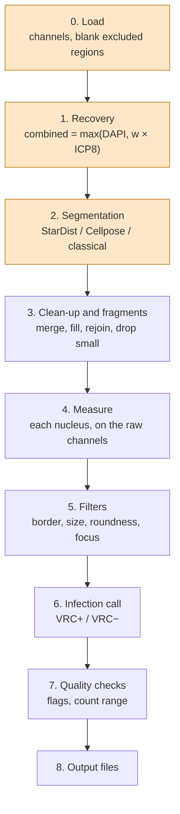
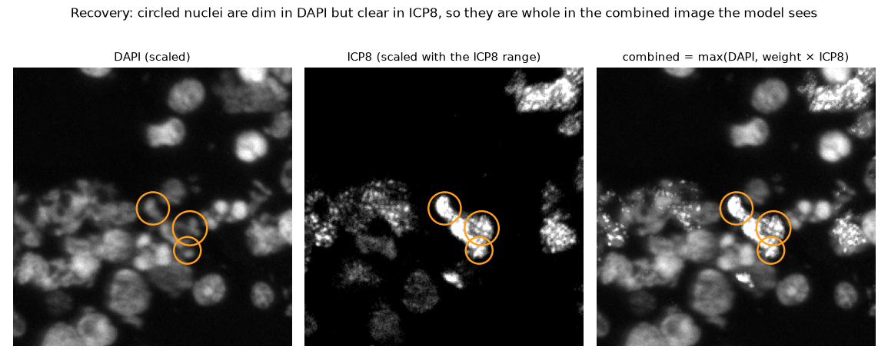

# How recap counts: the pipeline

[Guide](guide/README.md) · [Guided settings](guide/04-guided-settings.md) · [Output columns](output_columns.md)

This page explains what recap does to one image, from the file to the counts, and why. It is
for lab members who want to know what a setting really changes, and for developers who need to
find the code. The **recovery** step gets the most space, because it is the step that is
specific to HSV-1 and the one most likely to need attention for each staining batch.

The same code runs everywhere: `recap run`, the app's **Run** buttons, the **Settings** tab's
live preview, tuning and the spot check all call `recap.pipeline`.



Steps 0–2 (shaded) are the **slow stage** (`segment_stage`): they run the model. Steps 3–7 are
the **fast stage** (`finish_stage`) and take about a second. This is why, in the Settings tab,
changing the recovery or segmentation settings shows *Segmenting...* while changing a filter or
the infection call updates almost at once, and why tuning can try many filter settings quickly
(`pipeline.MODEL_STAGE_SETTINGS` lists the settings that need the slow stage again).

Every image uses its own **resolved settings**: the workspace's (`recap.yaml`), then its staining
batch's, then its own, the most specific winning
([levels](guide/04-guided-settings.md#us-16-see-where-each-setting-comes-from)).

## 0. Load

`io.load_channels`

- Reads the TIFF. A Fiji hyperstack (Z, C, Y, X) is reduced to one plane by a **maximum
  projection** over Z; an RGB export (Y, X, C) is turned into channels.
- Picks the channels named in `input:` (`dapi_channel`, `vrc_channel` = ICP8, optional
  `neuron_channel`).
- Sets every `input.exclude_regions` box to 0 in all channels: burned-in timestamps and scale
  bars are not nuclei. Nuclei touching these boxes are treated like nuclei at the image edge
  (step 5).

## 1. Recovery

`segment.combine` · Settings tab step 1 · `normalization:` in recap.yaml

### Why this step exists

The segmentation model looks for nuclei in one grey image. Normally that image would be DAPI.
In HSV-1 infection that fails for exactly the nuclei we want to count: as replication
compartments grow, the viral ICP8 protein fills the nucleus and the host chromatin is pushed to
the rim and condensed. An infected nucleus can therefore be **dim, patchy or ring-shaped in
DAPI** while being bright and solid in ICP8. A model fed DAPI alone misses many of them, or
cuts them into pieces, and the infected percentage comes out too low.

Recovery builds the image the model sees from both channels, so that a nucleus bright in
**either** DAPI or ICP8 is visible. Weak-DAPI infected nuclei are *recovered* into the image
before segmentation.



The picture is a region of the lab's day-79 example with the example workspace's settings.
recap's own outlines found the circled nuclei. Their DAPI is dim, because the chromatin is pushed
aside, but their ICP8 is bright, so they are clear in the combined image. Nuclei with good DAPI
look the same in the first and last panels.

### What it does

1. **DAPI is scaled per image.** Its 1st and 99.8th percentiles (`normalization.dapi_percentiles`)
   become 0 and 1; values outside are clipped. → `dapi_n`
2. **ICP8 is scaled to a range.** With a fixed `normalization.vrc_range: [min, max]`, the raw
   value *min* becomes 0 and *max* becomes 1, clipped, the same for every image. With
   `vrc_range: null` it uses each image's own 1st and 99.8th percentiles. → `vrc_n`
3. **The two are combined pixel by pixel:**

   ```
   combined = max(dapi_n, vrc_weight × vrc_n)
   ```

   (`normalization.vrc_weight`, default 1.0).

Taking the **maximum**, not the sum, means each pixel takes the brighter of the two signals: an
uninfected nucleus looks as it does in DAPI, an infected nucleus with weak DAPI looks as it
does in ICP8, and background stays dark because both channels are dark there. A sum would make
infected nuclei with good DAPI much brighter than the rest and blur the edges where the two
signals overlap.

**A worked example** with the example workspace's `vrc_range: [3, 25]`:

| Pixel | DAPI (scaled) | ICP8 raw → scaled | Combined (weight 1) |
|---|---|---|---|
| Uninfected nucleus | 0.60 | 3 → 0.00 | **0.60** (from DAPI) |
| Infected, chromatin pushed aside | 0.15 | 20 → (20 − 3) / (25 − 3) = 0.77 | **0.77** (recovered from ICP8) |
| Background | 0.02 | 2 → 0.00 | **0.02** |

In DAPI alone the infected nucleus is barely brighter than background; in the combined image it
is as clear as the uninfected one.

The combined image is only what the model **sees**. Measurements (step 4) are made on the
original DAPI and ICP8 values, and before StarDist runs, the combined image is stretched once
more to its own 1st–99.8th percentiles, as StarDist expects.

### The two settings

**ICP8 range** (`normalization.vrc_range`) — *fix it for each imaging session or staining
batch.*

- It decides which raw ICP8 values count as "no ICP8" (min) and "full ICP8" (max).
- **min** should sit just above the ICP8 background of uninfected cells: around the 95th
  percentile of background. Too low, and background haze enters the combined image and can
  look like nuclei. Too high, and weakly infected nuclei are not recovered.
- **max** should be about the brightness of a clearly infected nucleus in an infected control
  from the same session. Too high, and ICP8 never gets bright enough to help; too low only
  saturates bright nuclei, which is mostly harmless for recovery.
- **Why fixed rather than per image:** with `null`, every image is stretched to its own
  brightest pixels. An image with few or no infected cells is then stretched until its
  background noise looks like ICP8, which recovers false nuclei and, because the infection call
  uses the same scaled ICP8 (step 6), calls false VRC+ nuclei. A fixed range makes "VRC+" mean
  the same in every image of a session. recap flags images run without one
  (`vrc_range_not_fixed`).
- Images stained or imaged on different days usually need different ranges: save the range
  for the **staining batch**, not the whole workspace.

**ICP8 weight** (`normalization.vrc_weight`, 0.1–3) — *how much ICP8 can contribute.*

- 1.0 treats both channels equally once scaled. This is right for most batches.
- **Raise it** (1.2–2) when infected nuclei are still missed or broken up: their ICP8 signal
  then wins over their weak DAPI.
- **Lower it** (0.5–0.8) when ICP8 spills outside nuclei (cytoplasmic or diffuse staining) and
  outlines start following that signal instead of the nuclear edge, or when neighbouring
  infected nuclei merge into one outline.

### How to check it

- In the **Settings** tab, turn on the **recovered (DAPI + ICP8)** layer in the Show bar (it is
  off by default; see the [Settings tab picture](guide/04-guided-settings.md#us-13-adjust-settings-step-by-step)):
  it is exactly the combined image. It redraws instantly as you change the two
  settings. Infected nuclei should look as solid and well-edged as uninfected ones, with dark
  background between nuclei.
- Then compare the magenta (VRC+) and cyan (VRC−) outlines of the preview with what you see: a
  missed or broken infected nucleus usually means the weight is too low or the range minimum
  too high.
- After a run, the `high_vrc_background` flag (median scaled ICP8 outside nuclei above
  `qc.vrc_background_max`) usually means the range minimum is too low for that image.

From a terminal, the same settings:

```
recap settings set --batch "stain 2026-11-03" normalization.vrc_range=[3,25]
recap settings set --batch "stain 2026-11-03" normalization.vrc_weight=1.3
```

## 2. Segmentation

`segment.model_labels`, `segment.make_mask` · Settings tab step 2 · `segmentation:`

Finds the outline of every nucleus in the combined image. `segmentation.method`:

- **`stardist`** (the lab's choice): a model that predicts star-convex shapes. `stardist_model` is
  a pretrained name (`2D_versatile_fluo`) or a model the lab trained (`recap train`, under
  `recap-data/models/stardist/`). `stardist_scale` resizes the image first (below 1 for large
  nuclei; the example uses 0.75). `prob_thresh` (how sure the model must be; lower finds more)
  and `nms_thresh` (how much two nuclei may overlap; raise for crowded tissue) default to the
  model's own values. In the app, StarDist runs in a separate helper process; the result is the
  same.
- **`cellpose`**: Cellpose-SAM, or a model trained with `recap train --method cellpose`.
- **`classical`**: smoothing (`sigma`), a threshold (`otsu`, `li`, `triangle`), closing, hole
  filling, then a watershed on the distance map to split touching nuclei (`h`). No model needed;
  useful for testing.

`segmentation.diameter` is the typical nucleus width in pixels. Several defaults are derived
from it, notably the smallest object kept (`min_area`, default the area of a disk of diameter/2).

## 3. Clean-up and fragments

`segment.finish_labels` · Settings tab step 3

In order:

1. **Weak-border merge** (`segmentation.merge`, `merge_ratio`): joins touching regions whose shared
   border is about as bright as the dimmer region. Meant for the classical method; set
   `merge: false` with StarDist, which otherwise fuses touching nuclei.
2. **Fill holes** in each nucleus (ring-shaped infected nuclei become solid).
3. **Fragment merge** (`segmentation.fragment_merge`: `off`, `shape`, `shape_vrc`; thresholds in
   `fragments:`): a small or irregular piece is joined to the neighbour that gives the most
   convex, ellipse-like result of a normal size. `shape_vrc` also requires ICP8 across the join,
   for infected nuclei split along a replication compartment. Repeated up to three times. Each
   merge is listed in `<image>_merges.csv`.
4. **Small bodies** below `min_area` are removed (debris, apoptotic bodies); their number is
   `n_small_bodies` in the summary.

## 4. Measure

`measure.measure_nuclei`, `measure.object_features`

For each nucleus, on the **original** channel values (not the combined image): position, area,
solidity, DAPI and ICP8 totals and means, number of chromatin fragments, the share of its
pixels that are VRC+ (`vrc_area_fraction`, step 6), and the mean of the optional third channel in
a ring around the nucleus. On the combined image: roundness, a focus score (1.0 = the image's
median nucleus; measured on the combined image so infected nuclei with dim DAPI are not
mistaken for blurred ones), and whether it touches the edge or an excluded region, with an
estimate of how much of it is cut off. Every column is in [output_columns.md](output_columns.md).

## 5. Filters

`filters.apply_filters` · Settings tab step 4 · `filters:`

Removes outlines that are not whole, real, in-focus nuclei. Each removed nucleus keeps its
reason (`border`, `too_small`, `too_large`, `irregular`, `out_of_focus`) in
`<image>_excluded.csv` and is shown grey in the preview. A filter set to *off* (`null`) does
nothing.

- `exclude_border` drops nuclei cut by the edge or an excluded box; with `border_max_missing`
  (e.g. 0.15), a border nucleus is kept when it is estimated to be at most that much cut off and
  its shape and size are normal.
- `min_area` / `max_area`: infected nuclei swell, so keep `max_area` generous.
- `min_circularity` drops crescents and pieces; `min_focus` drops blurred nuclei.

## 6. Infection call

`measure.measure_nuclei` · Settings tab step 5 · `measurement:`

A pixel is VRC+ when its **scaled** ICP8 (`vrc_n`, from step 1) is above
`measurement.vrc_threshold` (default 0.3). A nucleus is **VRC+** when at least
`measurement.infected_fraction` (default 0.05, i.e. 5%) of its pixels are VRC+; otherwise VRC−.
Because the call uses the scaled ICP8, the ICP8 range from step 1 affects it too: changing the
range changes both which nuclei are found and which are called infected. Check both after
changing it.

## 7. Quality checks

`qc.image_qc`, `qc.batch_qc` · `qc:`

Warnings in the `qc_flags` column of the summary: saturated channels, few nuclei, many nuclei
filtered or out of focus, high ICP8 background, no fixed ICP8 range, and images much blurrier
than the rest of the run. The **count range** (`n_nuclei_low/high`, `n_infected_low/high`) shows
how sensitive the counts are: each active cutoff is moved down and up a little and the lowest
and highest counts are reported, without re-running the model. A wide range means the count
depends heavily on a setting and is worth checking by hand.

## 8. Output files

Per image, in `processed/batches/<batch>/<image>/` (or `processed/unbatched/<image>/`): the
nuclei table, merges, excluded nuclei, label images and a QC picture (white = VRC−, red = VRC+,
blue = excluded). Each image folder also keeps the outputs of the run before in `previous/`
and older runs zipped in `previous_runs/<date>.zip`. For the run as a whole, in
`processed/runs/<date>/`: all nuclei, the per-image summary and the run log. Columns: [output_columns.md](output_columns.md).

## Where the code is

| Step | Function |
|---|---|
| One image, both stages | `pipeline.process_image` = `finish_stage(segment_stage(...))` |
| 0 | `io.load_channels` |
| 1 | `segment.combine`, `segment.normalize`, `segment.vrc_range_for` |
| 2 | `segment.model_labels`, `segment.stardist_labels` (→ `stardist_worker` in the app), `segment.make_mask`, `segment.watershed_split` |
| 3 | `segment.finish_labels`, `segment.fragment_merge` |
| 4, 6 | `measure.measure_nuclei`, `measure.object_features` |
| 5 | `filters.apply_filters` |
| 7 | `qc.image_qc`, `qc.batch_qc`, `qc.count_range` |
| 8 | `pipeline.run_batch`, `runner` |
| Live preview | `gui.preview` (`recovered()` = step 1 only) |
